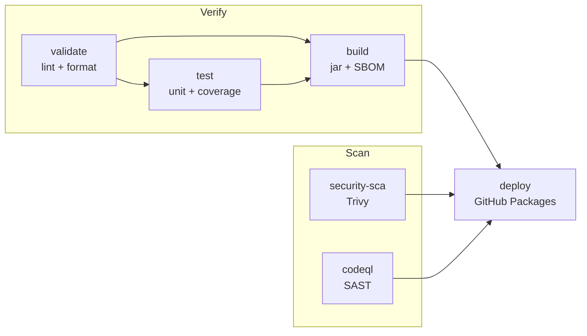

# Pipeline Guide — how the CI/CD works

**Audience:** anyone who needs to understand, change, debug or trust this repository's automation.
**Companion document:** [IMPLEMENTATION-GUIDE.md](IMPLEMENTATION-GUIDE.md) explains how the project
got here (decision history); this file explains how the pipeline behaves today.

---

## 1. TL;DR

| Question | Answer |
| --- | --- |
| Where is the pipeline defined? | `.github/workflows/ci.yml` (CI/CD) and `.github/workflows/release.yml` (releases) |
| What happens on a pull request? | `validate → test → build` plus both security scans; **no deploy** |
| What happens on a push to `main`? | the same, then **deploy** to GitHub Packages |
| What happens when I push a `vX.Y.Z` tag? | CI verifies + deploys that exact version, and a GitHub Release is published with the JAR, SBOM and checksums |
| How long does a full run take? | ~2 m 30 s on a cold runner (CodeQL dominates) |
| How do I reproduce a failure locally? | run the same Maven command shown in the job table (`9`) |

---

## 2. The two workflows

| Workflow | File | Purpose | Writes to |
| --- | --- | --- | --- |
| **CI** | `.github/workflows/ci.yml` | verify every change, scan it, publish the package | Packages, code scanning |
| **Release** | `.github/workflows/release.yml` | turn a tag into a GitHub Release with assets | Releases |

They are intentionally separate: CI answers “is this commit good?”, Release answers “ship this
version”. A tag push triggers both.

---

## 3. How the pipeline is wired



Dependency rules expressed with `needs`:

| Job | `needs` | Runs when |
| --- | --- | --- |
| `validate` | — | always |
| `test` | `validate` | validate passed |
| `build` | `validate`, `test` | both passed |
| `security-sca` | — | always (parallel, so a CVE is reported even if tests fail) |
| `codeql` | — | always (parallel) |
| `deploy` | `build`, `test`, `security-sca`, `codeql` | every job green **and** event is `push` or `workflow_dispatch` |

Security scans deliberately do **not** depend on the build: a dependency CVE must be visible even when
compilation is broken. Deploy is the opposite — it waits for everything.

---

## 4. Trigger matrix

| Event | Filter | CI | Release |
| --- | --- | --- | --- |
| Push | branch `main` | ✅ full, deploys `X-main.<run>` | — |
| Push | tag `v*.*.*` | ✅ full, deploys `X.Y.Z` | ✅ creates/updates the release |
| Pull request | base `main` | ✅ validate/test/build/scan only | — |
| Schedule | `17 3 * * 1` (Mon 03:17 UTC) | ✅ full (CVE drift check) | — |
| Manual | `workflow_dispatch` | ✅ deploy allowed | ✅ with a `tag` input |

A new push to the same ref cancels the previous run:

```yaml
concurrency:
  group: ci-${{ github.workflow }}-${{ github.ref }}
  cancel-in-progress: true
```

That is why a superseded run shows “Cancelling since a higher priority waiting request … exists”. It
is expected, not a failure.

---

## 5. Job reference

All jobs run on `ubuntu-latest` with Temurin JDK 17 and Maven dependency caching.

### 5.1 `validate` — "Validate · Lint & Format" (timeout 15 min)

```yaml
run: mvn -B -ntp enforcer:enforce     # toolchain + POM hygiene
run: mvn -B -ntp checkstyle:check     # static analysis
run: mvn -B -ntp spotless:check       # formatting
```

- Enforcer evaluates four rules: Maven ≥ 3.8.6, JDK ≥ 17, no duplicate dependency versions, dependency
  convergence.
- Checkstyle console output is summarized as `You have N Checkstyle violations.`
- Uploads `checkstyle-report` (`target/checkstyle-result.xml`, 7 days).

**Fails when:** a rule is violated, formatting drifted, or the POM resolves inconsistently.

### 5.2 `test` — "Test · Unit & Coverage" (timeout 20 min)

```yaml
run: mvn -B -ntp verify
```

Runs the full lifecycle up to `verify`, which includes a second pass of lint/format (intentional: the
local command and CI command are identical) plus JUnit 5, JaCoCo report and the coverage gate.

- Uploads `jacoco-report` (HTML/XML) and `surefire-reports`.
- Gate: line ≥ 80 %, branch ≥ 70 %, at least one measured class.

**Fails when:** a test fails, coverage drops below the gate, or the JaCoCo filter matches no classes.

### 5.3 `build` — "Build · Package" (timeout 15 min)

```yaml
run: mvn -B -ntp -DskipTests -Djacoco.skip=true package
```

- Produces `target/calculator-app-<version>.jar` (manifest with `Main-Class`) and `target/bom.json`
  (CycloneDX SBOM).
- Prints size, manifest and `sha256sum` into the log (audit trail).
- Uploads `calculator-app-dist` (JAR + SBOM, 14 days).

**Fails when:** packaging breaks, the manifest is missing, or the SBOM cannot be generated.

### 5.4 `security-sca` — "Security · Dependencies, Secrets & Config" (timeout 15 min)

Trivy filesystem scan, pinned to a commit SHA (`ed142fd…` = `v0.36.0`):

```yaml
scan-type: fs
scanners: vuln,secret,misconfig
severity: HIGH,CRITICAL
ignore-unfixed: true
format: sarif
exit-code: "1"
```

SARIF is uploaded to code scanning under `category: trivy`.

**Fails when:** a HIGH/CRITICAL vulnerability with a fix exists, or a secret pattern is detected.
`ignore-unfixed: true` prevents “no fix available” noise from blocking unrelated work.

### 5.5 `codeql` — "Security · SAST (CodeQL)" (timeout 30 min)

`init` (`java-kotlin`, `security-extended`) → `setup-java` → `autobuild` → `analyze`.
Autobuild runs Maven, so the project must compile; results appear under `/language:java-kotlin`.

**Fails when:** the project cannot be built, or CodeQL cannot upload results.

### 5.6 `deploy` — "Deploy · GitHub Packages" (timeout 15 min)

Runs only for `push`/`workflow_dispatch` and only after every other job passes, behind the
`production` environment with `packages: write`.

Steps: resolve version → write `~/.m2/settings.xml` (server id `github`) → `mvn … deploy`.

**Fails when:** permissions are missing (`403`), the version already exists (`409`), or the server id
in the settings file does not match `distributionManagement` in the POM.

---

## 6. Versioning rules

```text
push to main        ->  <revision>-main.<run_number>      e.g. 1.0.0-main.21
push tag v1.2.3     ->  1.2.3
```

- `<revision>` is the POM property (`1.0.0` today), injected with `-Drevision=…`.
- The `-main.<run>` suffix keeps coordinates unique, because registries reject republishing a version.
- Tags are the single source of truth for released versions — no POM edit is needed to ship.

Resolution logic (from `ci.yml`):

```bash
BASE="$(mvn -q -DforceStdout help:evaluate -Dexpression=revision | tail -n 1)"
if [[ "${GITHUB_REF_TYPE}" == "tag" ]]; then
  VERSION="${GITHUB_REF_NAME#v}"
else
  VERSION="${BASE}-main.${GITHUB_RUN_NUMBER}"
fi
```

---

## 7. Release flow

```text
git tag v1.0.0 --> CI: validate/test/build/scan --> deploy 1.0.0 to Packages
               --> Release: mvn verify -Drevision=1.0.0
                     |- sha256sum jar + bom.json -> SHA256SUMS
                     |- gh release create|upload  (JAR, bom.json, SHA256SUMS)
```

Details that matter:

- Assets are attached with `--clobber` when the release already exists, so re-running a release job is
  safe and the UI-created release is reconciled.
- `--generate-notes` produces the changelog from commits and previous tags; `fetch-depth: 0` is required
  for that.
- A tag such as `v1.1.0-rc1` is published as a pre-release automatically.
- The release job publishes artifacts only — it does not deploy to Packages (the deploy job does).

---

## 8. Reading a run

1. **Actions → CI → pick the run.** The left column lists jobs; the top shows total duration.
2. **Annotations** (top of the run) summarize errors without opening logs — e.g. “Process completed with
   exit code 1”.
3. **Open the job → click a step** to load its log. GitHub also offers *Download log archive* and
   *Re-run failed jobs*.
4. **Artifacts** at the bottom contain the checkstyle XML, JaCoCo HTML, surefire reports and the JAR.
5. For deeper debugging, set repository secret `ACTIONS_STEP_DEBUG=true` (and `ACTIONS_RUNNER_DEBUG`)
   — the next run will emit verbose logs.

Typical cold-run timings on the free runner pool:

| Job | Time |
| --- | --- |
| validate | ~20 s |
| test | ~30 s |
| build | ~20 s |
| security-sca | ~25 s |
| codeql | ~1 m 45 s |
| deploy | ~30 s |
| **total** | **~2 m 35 s** |

---

## 9. Reproducing CI locally

| CI step | Local command |
| --- | --- |
| Enforcer | `mvn enforcer:enforce` |
| Checkstyle | `mvn checkstyle:check` |
| Spotless check | `mvn spotless:check` |
| All lint/format | `mvn validate` |
| Tests + coverage gate | `mvn verify` |
| Package only | `mvn -DskipTests -Djacoco.skip=true package` |
| Full deploy to Packages | `mvn -Drevision=1.0.0 -DskipTests -Djacoco.skip=true deploy` (needs `~/.m2/settings.xml`) |

Prerequisites are the same as CI enforces: **JDK 17+**, **Maven 3.8.6+**.
Coverage report: open `target/site/jacoco/index.html`.

---

## 10. Failure playbook

| Log signature | Meaning | Fix |
| --- | --- | --- |
| `Rule 0: RequireJavaVersion failed` | wrong JDK locally or in the image | use JDK 17+; CI pins Temurin 17 |
| `You have 5 Checkstyle violations.` | style/lint violations | `mvn checkstyle:check`, inspect `target/checkstyle-result.xml` |
| `Spotless.Java … needs changes` | formatting drift | `mvn spotless:apply` and commit |
| `Tests run: 54, Failures: 1` | failing assertion | open the `surefire-reports` artifact |
| `Rule violated … lines covered ratio is 0.71` | coverage below the gate | add tests; check `target/site/jacoco/index.html` |
| `Analyzed bundle … with 0 classes` | JaCoCo filter matched nothing (gate is meaningless) | use VM-style pattern `com/mycompany/calculator/*` |
| Trivy step exits 1 | HIGH/CRITICAL CVE or secret | upgrade the dependency; read the SARIF entry in *Security → Code scanning* |
| CodeQL “autobuild failed” | project does not compile | `mvn -DskipTests package` locally |
| Deploy `401/403` | token lacks permission | job needs `packages: write` |
| Deploy `409 Conflict` | version already published | branch builds already use `-main.<run>`; bump the tag version |
| Release “release already exists” | manual release created first | job is idempotent — verify the `gh release view` branch is present |
| `waiting for another serialized run` | concurrency group is busy | wait, or cancel the older run |
| “Invalid workflow file” | YAML syntax/indentation error | validate the YAML before pushing |

---

## 11. Changing the pipeline

**Add a step** to an existing job (keep the `name:` — it becomes the check name in the UI):

```yaml
      - name: Dependency tree
        run: mvn -B -ntp dependency:tree
```

**Add a job** — declare it after its prerequisites and wire the gate:

```yaml
  docs:
    name: "Docs · Link check"
    needs: [validate]
    runs-on: ubuntu-latest
    timeout-minutes: 10
    steps:
      - uses: actions/checkout@v7
        with:
          persist-credentials: false
      - run: echo "add a checker here"
```

**Run a matrix** (for example JDK 17 and 21):

```yaml
    strategy:
      fail-fast: false
      matrix:
        java: ["17", "21"]
    steps:
      - uses: actions/setup-java@v6
        with:
          distribution: temurin
          java-version: ${{ matrix.java }}
```

YAML gotchas that break `ci.yml`:

- Tabs are illegal — spaces only (2 per level).
- `run:` blocks are shell scripts; indentation inside them is preserved and meaningful.
- `${{ … }}` is evaluated by GitHub **before** the shell sees it; shell variables use `$NAME` inside
  the block instead.
- A step is either a `run:` **or** a `uses:` — never both.
- Job ids are lowercase; job `name:` is free text and is what branch protection matches.

---

## 12. Security model of the pipeline

| Control | How it is implemented |
| --- | --- |
| Least privilege | workflow default `contents: read`; `security-events: write` only on scanning jobs; `packages: write` only on deploy |
| No credential persistence | `persist-credentials: false` on every checkout |
| Third-party pinning | Trivy pinned to a commit SHA; GitHub-owned actions on major tags; Dependabot proposes bumps |
| Immutable evidence | checksums printed in the build log, SBOM attached to the artifact and the release |
| Findings routing | SARIF uploaded to code scanning (`category: trivy` and `/language:java-kotlin`) |
| Environment gate | `production` environment on deploy (add required reviewers to require approval) |

---

## 13. Required checks and environments

When enabling a ruleset for `main`, require exactly these check names (they come from the job `name:`
fields):

```text
Validate · Lint & Format
Test · Unit & Coverage
Build · Package
Security · Dependencies, Secrets & Config
Security · SAST (CodeQL)
```

Do **not** require `Deploy · GitHub Packages` on pull requests — it never runs there, so the PR would
wait forever.

Environment: `Settings → Environments → production` — add required reviewers and a wait timer to make
deployments and releases approval-based.

---

## 14. FAQ

**Why does linting run twice (validate job and again inside `verify`)?**
Because the local command (`mvn verify`) must be identical to CI. The duplicate pass costs a few
seconds and removes the classic “works locally, fails in CI” drift.

**Why is `security-sca` not blocked by failing tests?**
A vulnerable dependency must be visible even when the build is red; otherwise a broken build silently
hides a CVE.

**Why package in `build` if `test` already runs `package`?**
`test` proves correctness; `build` proves the shippable artifact (manifest, SBOM, checksum) and is the
only job that uploads the distribution.

**Can we skip the pipeline for docs-only changes?**
Not configured today. Adding `paths-ignore` is possible but reduces the signal on the default branch;
a lighter option is to keep the full run and rely on concurrency cancellation.

**How do I deploy without a new commit?**
`Actions → CI → Run workflow` on `main`. It deploys a fresh `-main.<run>` version.

**How do I re-release an existing tag?**
`Actions → Release → Run workflow` with the tag name as input; assets are refreshed idempotently.

**Where do I see what was deployed?**
*Settings → Environments → production* (deployment history) and the package versions list.

---

## 15. Quick reference

| Item | Value |
| --- | --- |
| JDK | Temurin 17 (`JAVA_VERSION`) |
| Maven flags | `-B -ntp -Dstyle.color=always` (`MAVEN_ARGS`) |
| Artifacts | `checkstyle-report`, `jacoco-report`, `surefire-reports`, `calculator-app-dist` |
| Retention | 7 days (reports), 14 days (distribution) |
| Package coordinates | `com.mycompany:calculator-app` |
| Registry | `https://maven.pkg.github.com/ZarifRamzan/Calculator-javaProject` |
| Release assets | JAR, `bom.json`, `SHA256SUMS` |
| Failure entry point | *Actions → run → job → step log*, plus the Annotations panel |
