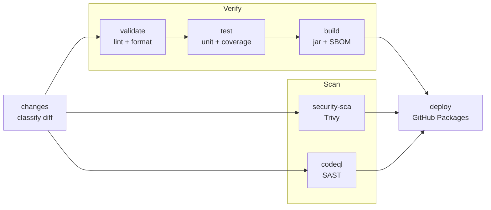

# Pipeline Guide — how the CI/CD works

**Audience:** anyone who needs to understand, change, debug or trust this repository's automation.
**Companion document:** [IMPLEMENTATION-GUIDE.md](IMPLEMENTATION-GUIDE.md) explains how the project
got here (decision history); this file explains how the pipeline behaves today.

---

## Table of contents

1. [TL;DR](#1-tldr)
2. [The three workflows](#2-the-three-workflows)
3. [How the pipeline is wired](#3-how-the-pipeline-is-wired)
4. [Triggers](#4-triggers)
5. [Job reference](#5-job-reference)
6. [Versioning rules](#6-versioning-rules)
7. [Release flow](#7-release-flow)
8. [Rollback](#8-rollback)
9. [Reading a run](#9-reading-a-run)
10. [Reproducing CI locally](#10-reproducing-ci-locally)
11. [Failure playbook](#11-failure-playbook)
12. [Changing the pipeline](#12-changing-the-pipeline)
13. [Security model](#13-security-model)
14. [Required checks and environments](#14-required-checks-and-environments)
15. [FAQ](#15-faq)
16. [Quick reference](#16-quick-reference)

---

## 1. TL;DR

| Question | Answer |
| --- | --- |
| Where is the pipeline defined? | `.github/workflows/ci.yml` (build/test/scan/deploy), `release.yml` (releases), `rollback.yml` (recovery) |
| What happens on a pull request? | `validate → test → build` plus both security scans; **no deploy** |
| What happens on a push to `main`? | the same, then **deploy** to GitHub Packages |
| What happens when I push a `vX.Y.Z` tag? | CI verifies + deploys that exact version, and a GitHub Release is published with the JAR, SBOM and checksums |
| What happens on a documentation-only change? | only the `Detect changes` job runs (~20 s); build, test, security and deploy are skipped |
| How do I recover from a bad release? | run the **Rollback** workflow with the version to restore (`8`) |
| How long does a full run take? | ~2 m 20 s on a cold runner (CodeQL dominates) |
| How do I reproduce a failure locally? | run the same Maven command shown in the job table (`10`) |

---

## 2. The three workflows

| Workflow | File | Trigger | Purpose | Writes to |
| --- | --- | --- | --- | --- |
| **CI** | `.github/workflows/ci.yml` | push, PR, tag, schedule, manual | verify, scan and publish the package | Packages, code scanning |
| **Release** | `.github/workflows/release.yml` | tag `v*.*.*`, manual | turn a tag into a GitHub Release with assets | Releases |
| **Rollback** | `.github/workflows/rollback.yml` | manual only | restore a known-good version, optionally revoke the broken one | Packages, Releases, deployment history |

CI answers “is this commit good?”, Release answers “ship this version”, Rollback answers “undo it”.
A tag push triggers CI and Release.

---

## 3. How the pipeline is wired



Dependency rules expressed with `needs`:

| Job | `needs` | Runs when |
| --- | --- | --- |
| `changes` | — | always (cheap classifier) |
| `validate` | `changes` | code changed |
| `test` | `changes`, `validate` | code changed and validate passed |
| `build` | `changes`, `validate`, `test` | code changed and both passed |
| `security-sca` | `changes` | code changed (parallel, so a CVE is reported even if tests fail) |
| `codeql` | `changes` | code changed (parallel) |
| `deploy` | `changes`, `build`, `test`, `security-sca`, `codeql` | code changed, every job green, event is `push` or `workflow_dispatch` |

Security scans deliberately do **not** depend on the build: a dependency CVE must be visible even when
compilation is broken. Deploy is the opposite — it waits for everything.

---

## 4. Triggers

| Event | Filter | CI | Release | Rollback |
| --- | --- | --- | --- | --- |
| Push | branch `main`, code change | ✅ full, deploys `X-main.<run>` | — | — |
| Push | branch `main`, docs only | ✅ `Detect changes` only | — | — |
| Push | tag `v*.*.*` | ✅ full (always), deploys `X.Y.Z` | ✅ creates/updates the release | — |
| Pull request | base `main` | ✅ validate/test/build/scan only | — | — |
| Schedule | `17 3 * * 1` (Mon 03:17 UTC) | ✅ full (CVE drift check) | — | — |
| Manual | `workflow_dispatch` | ✅ full, deploy allowed | ✅ with a `tag` input | ✅ with `version` input |

A new push to the same ref cancels the previous CI run:

```yaml
concurrency:
  group: ci-${{ github.workflow }}-${{ github.ref }}
  cancel-in-progress: true
```

Rollback deliberately does **not** cancel in progress (`cancel-in-progress: false`): a recovery must
never be interrupted by another recovery.

### 4.1 Documentation-only changes

The first job, `Detect changes`, classifies the diff and exposes the `code` output that every other job
consumes via `if: needs.changes.outputs.code == 'true'`.

**Considered documentation** (only these paths skip the pipeline):

```text
docs/**        any file under the docs folder
*.md           Markdown anywhere (README, docs, changelogs)
LICENSE
.gitignore
.editorconfig
```

Everything else — Java sources, tests, `pom.xml`, `.github/**`, config — counts as code and triggers
the full pipeline. The rule is deliberately conservative: when in doubt, run everything.

How the base commit is chosen:

| Event | Diff base |
| --- | --- |
| `pull_request` | `github.event.pull_request.base.sha` |
| `push` | `github.event.before` (previous head of the branch) |
| missing / all-zero SHA | first commit of the repository (full diff) |
| `schedule`, `workflow_dispatch`, tag builds | no diff — always full pipeline |

Safety behaviour: if the diff cannot be computed (for example after a force-push), the job logs
`Cannot diff against …: running the full pipeline` and reports `code=true` rather than skipping work it
cannot reason about.

**Why job conditions instead of `paths-ignore`?**
With `on.pull_request.paths-ignore` the workflow never starts, so required status checks stay
“Expected — waiting for status to be reported” and the pull request can never merge. A skipped job, by
contrast, is reported as successful, so branch protection keeps working while the heavy work is
avoided.

---

## 5. Job reference

All jobs run on `ubuntu-latest` with Temurin JDK 17 and Maven dependency caching, and every job below
starts with `needs: changes` plus the `code` condition.

### 5.0 `changes` — "Detect changes" (timeout 5 min)

Checks out with `fetch-depth: 0` and diffs the base commit against `GITHUB_SHA`. Outputs `code`
(`true`/`false`) and prints the changed file list in the log.

### 5.1 `validate` — "Validate · Lint & Format" (timeout 15 min)

```yaml
run: mvn -B -ntp enforcer:enforce     # toolchain + POM hygiene
run: mvn -B -ntp checkstyle:check     # static analysis
run: mvn -B -ntp spotless:check       # formatting
```

This is the **single** lint/format stage. Every downstream job passes
`-Dcheckstyle.skip=true -Dspotless.check.skip=true` (`SKIP_LINT` in the workflow environment), so the
same analysis is never paid for three times.

- Enforcer evaluates four rules: Maven ≥ 3.8.6, JDK ≥ 17, no duplicate dependency versions, dependency
  convergence.
- Checkstyle console output is summarized as `You have N Checkstyle violations.`
- Uploads `checkstyle-report` (`target/checkstyle-result.xml`, 7 days).

**Fails when:** a rule is violated, formatting drifted, or the POM resolves inconsistently.

### 5.2 `test` — "Test · Unit & Coverage" (timeout 20 min)

```yaml
run: mvn -B -ntp $SKIP_LINT -Dcyclonedx.skip=true verify
```

Runs the lifecycle up to `verify`: JUnit 5, JaCoCo report and the coverage gate. Lint is skipped
(already done) and so is SBOM generation (the `build` job owns it), which keeps this job to the work
that actually proves correctness.

- Uploads `jacoco-report` (HTML/XML) and `surefire-reports`.
- Gate: line ≥ 80 %, branch ≥ 70 %, at least one measured class.

**Fails when:** a test fails, coverage drops below the gate, or the JaCoCo filter matches no classes.

### 5.3 `build` — "Build · Package" (timeout 15 min)

```yaml
run: mvn -B -ntp $SKIP_LINT -DskipTests -Djacoco.skip=true package
```

- Produces `target/calculator-app-<version>.jar` (manifest with `Main-Class`) and `target/bom.json`
  (CycloneDX SBOM).
- Prints size, manifest and `sha256sum` into the log (audit trail).
- Uploads `calculator-app-dist` (JAR + SBOM, 14 days).

**Fails when:** packaging breaks, the manifest is missing, or the SBOM cannot be generated.

### 5.4 `security-sca` — "Security · Dependencies, Secrets & Config" (timeout 15 min)

Trivy filesystem scan, pinned to a commit SHA (`ed142fd…` = `v0.36.0`):

```yaml
scan-type: fs
scanners: vuln,secret,misconfig
severity: HIGH,CRITICAL
ignore-unfixed: true
format: sarif
exit-code: "1"
```

SARIF is uploaded to code scanning under `category: trivy`.

**Fails when:** a HIGH/CRITICAL vulnerability with a fix exists, or a secret pattern is detected.
`ignore-unfixed: true` prevents “no fix available” noise from blocking unrelated work.

### 5.5 `codeql` — "Security · SAST (CodeQL)" (timeout 30 min)

`init` (`java-kotlin`, `security-extended`) → `setup-java` → `autobuild` → `analyze`.
Autobuild runs Maven, so the project must compile; results appear under `/language:java-kotlin`.

**Fails when:** the project cannot be built, or CodeQL cannot upload results.

### 5.6 `deploy` — "Deploy · GitHub Packages" (timeout 15 min)

Runs only for `push`/`workflow_dispatch`, only for code changes, and only after every other job
passes, behind the `production` environment with `packages: write`.

Steps: resolve version → write `~/.m2/settings.xml` (server id `github`) → `mvn … deploy` with the
same `SKIP_LINT`/`skipTests`/`jacoco.skip` flags, so it publishes exactly what was already verified
instead of re-running the checks.

**Fails when:** permissions are missing (`403`), the version already exists (`409`), or the server id
in the settings file does not match `distributionManagement` in the POM.

---

## 6. Versioning rules

```text
push to main        ->  <revision>-main.<run_number>      e.g. 1.0.0-main.21
push tag v1.2.3     ->  1.2.3
```

- `<revision>` is the POM property (`1.0.0` today), injected with `-Drevision=…`.
- The `-main.<run>` suffix keeps coordinates unique, because registries reject republishing a version.
- Tags are the single source of truth for released versions — no POM edit is needed to ship.

Resolution logic (from `ci.yml`):

```bash
BASE="$(mvn -q -DforceStdout help:evaluate -Dexpression=revision | tail -n 1)"
if [[ "${GITHUB_REF_TYPE}" == "tag" ]]; then
  VERSION="${GITHUB_REF_NAME#v}"
else
  VERSION="${BASE}-main.${GITHUB_RUN_NUMBER}"
fi
```

---

## 7. Release flow

```text
git tag v1.0.0 --> CI: validate/test/build/scan --> deploy 1.0.0 to Packages
               --> Release: mvn verify -Drevision=1.0.0
                     |- sha256sum jar + bom.json -> SHA256SUMS
                     |- gh release create|upload  (JAR, bom.json, SHA256SUMS)
```

Details that matter:

- Assets are attached with `--clobber` when the release already exists, so re-running a release job is
  safe and the UI-created release is reconciled.
- `--generate-notes` produces the changelog from commits and previous tags; `fetch-depth: 0` is required
  for that.
- A tag such as `v1.1.0-rc1` is published as a pre-release automatically.
- The release job publishes artifacts only — it does not deploy to Packages (the deploy job does).

---

## 8. Rollback

**Workflow:** `.github/workflows/rollback.yml` — manual, gated by the `production` environment,
`contents: write` + `packages: write`, never cancelled by concurrency.

| Input | Required | Meaning |
| --- | --- | --- |
| `version` | yes | the known-good version to restore (for example `1.0.0`); a leading `v` is stripped |
| `failed_version` | no | the broken package version to revoke |
| `delete_failed_version` | no (default `false`) | actually delete `failed_version` from GitHub Packages |
| `reason` | no | recorded in the run summary and the environment history |

What the job does, in order:

1. **Validate the request** — normalises `v`-prefixed versions, refuses an empty target, refuses to
   delete the version being restored.
2. **Verify the target exists** — resolves `/com/mycompany/calculator-app/<version>/calculator-app-<version>.pom`
   against the Maven registry, following the registry's redirect (`curl -sL`) and requiring HTTP 200.
   A missing version fails here, before anything is changed.
3. **Re-point “Latest”** — if a GitHub Release `v<version>` exists, `gh release edit --latest` makes it the
   current release again.
4. **Revoke the broken version (opt-in)** — looks the version id up through the Packages API and deletes
   it. Destructive, which is why it is a separate flag and skipped by default.
5. **Record the outcome** — writes a table (restored version, revoked version, requester, reason) to the
   job summary; the `production` environment keeps the deployment history.

```text
Actions → Rollback → Run workflow
  version: 1.0.0
  failed_version: 1.0.0-main.42
  delete_failed_version: false
  reason: "main.42 shipped a broken build"
```

Notes:

- Rollback cannot “un-deploy” a version that consumers already resolved; it restores the pointer to a
  known-good coordinate and, if asked, removes the broken one so it cannot be pulled again.
- Deleting a package version is irreversible and breaks anyone pinning it — keep the flag off unless
  the version must disappear (for example a leaked artifact).
- The rollback workflow is independent of CI, so it still works when `main` is red.

---

## 9. Reading a run

1. **Actions → CI → pick the run.** The left column lists jobs; the top shows total duration.
2. **Annotations** (top of the run) summarize errors without opening logs — e.g. “Process completed with
   exit code 1”.
3. **Open the job → click a step** to load its log. GitHub also offers *Download log archive* and
   *Re-run failed jobs*.
4. **Artifacts** at the bottom contain the checkstyle XML, JaCoCo HTML, surefire reports and the JAR.
5. For deeper debugging, set repository secret `ACTIONS_STEP_DEBUG=true` (and `ACTIONS_RUNNER_DEBUG`)
   — the next run will emit verbose logs.

Typical cold-run timings on the free runner pool (after the lint-once optimisation):

| Scenario | Time |
| --- | --- |
| docs-only change | ~20 s (`Detect changes` only) |
| validate | ~25 s |
| test | ~30 s |
| build | ~25 s |
| security-sca | ~20 s |
| codeql | ~1 m 40 s |
| deploy | ~25 s |
| **full run total** | **~2 m 20 s** |

---

## 10. Reproducing CI locally

| CI step | Local command |
| --- | --- |
| Enforcer | `mvn enforcer:enforce` |
| Checkstyle | `mvn checkstyle:check` |
| Spotless check | `mvn spotless:check` |
| All lint/format | `mvn validate` |
| Tests + coverage gate | `mvn verify` (runs lint too, unlike CI) |
| Package only | `mvn -DskipTests -Djacoco.skip=true package` |
| Full deploy to Packages | `mvn -Drevision=1.0.0 -DskipTests -Djacoco.skip=true deploy` (needs `~/.m2/settings.xml`) |

Prerequisites are the same as CI enforces: **JDK 17+**, **Maven 3.8.6+**.
Coverage report: open `target/site/jacoco/index.html`.

> CI skips lint in `test`/`build`/`deploy` only because `validate` already ran it. A plain
> `mvn verify` locally is therefore slightly stricter than any single CI job — that is intentional.

---

## 11. Failure playbook

| Log signature | Meaning | Fix |
| --- | --- | --- |
| `Rule 0: RequireJavaVersion failed` | wrong JDK locally or in the image | use JDK 17+; CI pins Temurin 17 |
| `You have 5 Checkstyle violations.` | style/lint violations | `mvn checkstyle:check`, inspect `target/checkstyle-result.xml` |
| `Spotless.Java … needs changes` | formatting drift | `mvn spotless:apply` and commit |
| `Tests run: 54, Failures: 1` | failing assertion | open the `surefire-reports` artifact |
| `Rule violated … lines covered ratio is 0.71` | coverage below the gate | add tests; check `target/site/jacoco/index.html` |
| `Analyzed bundle … with 0 classes` | JaCoCo filter matched nothing (gate is meaningless) | use VM-style pattern `com/mycompany/calculator/*` |
| Trivy step exits 1 | HIGH/CRITICAL CVE or secret | upgrade the dependency; read the SARIF entry in *Security → Code scanning* |
| CodeQL “autobuild failed” | project does not compile | `mvn -DskipTests package` locally |
| Deploy `401/403` | token lacks permission | job needs `packages: write` |
| Deploy `409 Conflict` | version already published | branch builds already use `-main.<run>`; bump the tag version |
| `Cannot diff against …` | base commit unavailable (force-push) | expected fallback: the full pipeline runs |
| All jobs “skipped” | the change was documentation-only | expected; `Detect changes` explains which files matched |
| Rollback: `Version … is not available` | wrong version or not yet published | pick a version listed under *Packages* |
| Rollback: `Could not find version …` | the registry check passed but the API cannot see it | check the package name and permissions |
| Release “release already exists” | manual release created first | job is idempotent — verify the `gh release view` branch is present |
| `waiting for another serialized run` | concurrency group is busy | wait, or cancel the older run |
| “Invalid workflow file” | YAML syntax/indentation error | validate the YAML before pushing |

---

## 12. Changing the pipeline

**Add a step** to an existing job (keep the `name:` — it becomes the check name in the UI):

```yaml
      - name: Dependency tree
        run: mvn -B -ntp dependency:tree
```

**Add a job** — declare it after its prerequisites and wire both the gate and the condition:

```yaml
  docs:
    name: "Docs · Link check"
    needs: changes
    if: needs.changes.outputs.code == 'true'
    runs-on: ubuntu-latest
    timeout-minutes: 10
    steps:
      - uses: actions/checkout@v7
        with:
          persist-credentials: false
      - run: echo "add a checker here"
```

**Run a matrix** (for example JDK 17 and 21):

```yaml
    strategy:
      fail-fast: false
      matrix:
        java: ["17", "21"]
    steps:
      - uses: actions/setup-java@v6
        with:
          distribution: temurin
          java-version: ${{ matrix.java }}
```

**Extend or tighten the docs allow-list:** the `case` statement in the `changes` job decides what is
“documentation”. Add paths there if a new documentation folder appears; keep the list conservative —
anything that can affect a build, test or scan must stay in the “code” bucket.

**Keep the lint-once rule:** if you add a job that runs Maven, include `$SKIP_LINT` unless the job is
`validate` itself. Otherwise CI starts paying for the same analysis again.

YAML gotchas that break `ci.yml`:

- Tabs are illegal — spaces only (2 per level).
- `run:` blocks are shell scripts; indentation inside them is preserved and meaningful.
- `${{ … }}` is evaluated by GitHub **before** the shell sees it; shell variables use `$NAME` inside
  the block instead.
- A step is either a `run:` **or** a `uses:` — never both.
- Job ids are lowercase; job `name:` is free text and is what branch protection matches.

---

## 13. Security model of the pipeline

| Control | How it is implemented |
| --- | --- |
| Least privilege | workflow default `contents: read`; `security-events: write` only on scanning jobs; `packages: write` only on deploy/rollback; `contents: write` only on release/rollback |
| No credential persistence | `persist-credentials: false` on every checkout |
| Third-party pinning | Trivy pinned to a commit SHA; GitHub-owned actions on major tags; Dependabot proposes bumps |
| Immutable evidence | checksums printed in the build log, SBOM attached to the artifact and the release |
| Findings routing | SARIF uploaded to code scanning (`category: trivy` and `/language:java-kotlin`) |
| Environment gate | `production` environment on deploy and rollback (add required reviewers) |
| Reversibility | rollback workflow requires an explicit version and separates restore from destructive delete |

---

## 14. Required checks and environments

When enabling a ruleset for `main`, require exactly these check names (they come from the job `name:`
fields):

```text
Validate · Lint & Format
Test · Unit & Coverage
Build · Package
Security · Dependencies, Secrets & Config
Security · SAST (CodeQL)
```

Do **not** require `Deploy · GitHub Packages` on pull requests — it never runs there, so the PR would
wait forever. The same applies to the Rollback workflow (manual only).

Docs-only pull requests are safe with these checks: their jobs are reported as *skipped*, which counts
as successful, so the pull request stays mergeable.

Environment: `Settings → Environments → production` — add required reviewers and a wait timer so that
deployments, releases and rollbacks are approval-based.

---

## 15. FAQ

**Why does the pipeline skip lint in test/build/deploy?**
Because `validate` already ran exactly the same Checkstyle and Spotless configuration on the same
commit. Running it again costs time without adding signal — the gate is still enforced, once, before
anything else.

**Why is `security-sca` not blocked by failing tests?**
A vulnerable dependency must be visible even when the build is red; otherwise a broken build silently
hides a CVE.

**Why package in `build` if `test` already runs `package`?**
`test` proves correctness; `build` proves the shippable artifact (manifest, SBOM, checksum) and is the
only job that uploads the distribution.

**Can we skip the pipeline for docs-only changes?**
Yes — implemented with the `changes` gate described in `4.1. Only `Detect changes` runs (~20 s);
`validate`, `test`, `build`, both security jobs and `deploy` are skipped, and the pull request checks
still report success.

**What if a docs-only change actually breaks something?**
It cannot by construction: the classifier only skips paths that are not compiled, tested, scanned or
packaged. Anything else — including `pom.xml` and `.github/**` — is treated as code.

**How do I roll back a bad version?**
Run the Rollback workflow with the known-good `version` (`8`). It never deletes anything unless you set
`delete_failed_version`.

**How do I deploy without a new commit?**
`Actions → CI → Run workflow` on `main`. Manual runs always execute the full pipeline and deploy a
fresh `-main.<run>` version.

**How do I re-release an existing tag?**
`Actions → Release → Run workflow` with the tag name as input; assets are refreshed idempotently.

**Where do I see what was deployed?**
*Settings → Environments → production* (deployment history) and the package versions list.

---

## 16. Quick reference

| Item | Value |
| --- | --- |
| JDK | Temurin 17 (`JAVA_VERSION`) |
| Maven flags | `-B -ntp -Dstyle.color=always` (`MAVEN_ARGS`) |
| Lint-once flag | `-Dcheckstyle.skip=true -Dspotless.check.skip=true` (`SKIP_LINT`) |
| Gate job | `Detect changes` → output `code` (`true`/`false`) |
| Docs paths | `docs/**`, `*.md`, `LICENSE`, `.gitignore`, `.editorconfig` |
| Artifacts | `checkstyle-report`, `jacoco-report`, `surefire-reports`, `calculator-app-dist` |
| Retention | 7 days (reports), 14 days (distribution) |
| Package coordinates | `com.mycompany:calculator-app` |
| Registry | `https://maven.pkg.github.com/ZarifRamzan/Calculator-javaProject` |
| Release assets | JAR, `bom.json`, `SHA256SUMS` |
| Rollback | `Actions → Rollback → Run workflow` (`version`, optional `failed_version`) |
| Failure entry point | *Actions → run → job → step log*, plus the Annotations panel |
